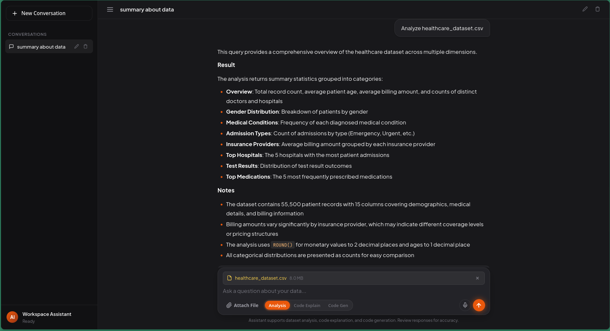
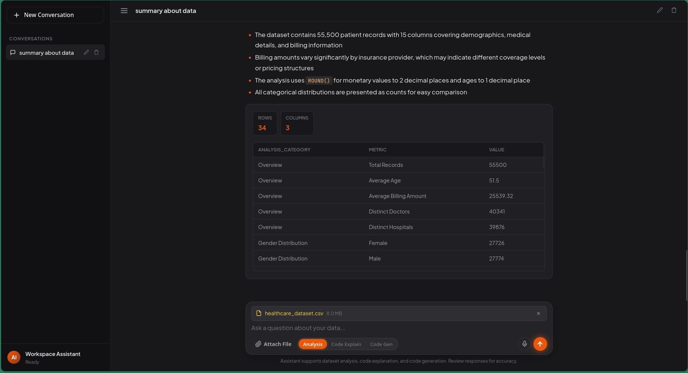
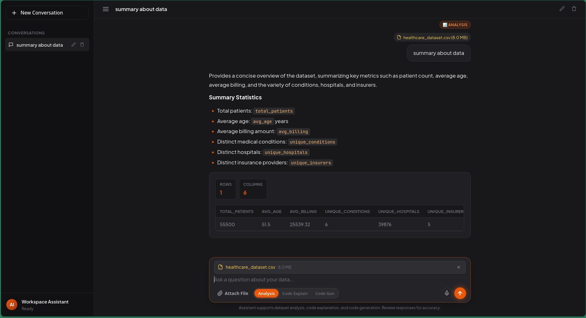
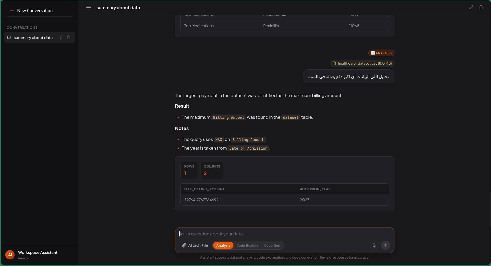
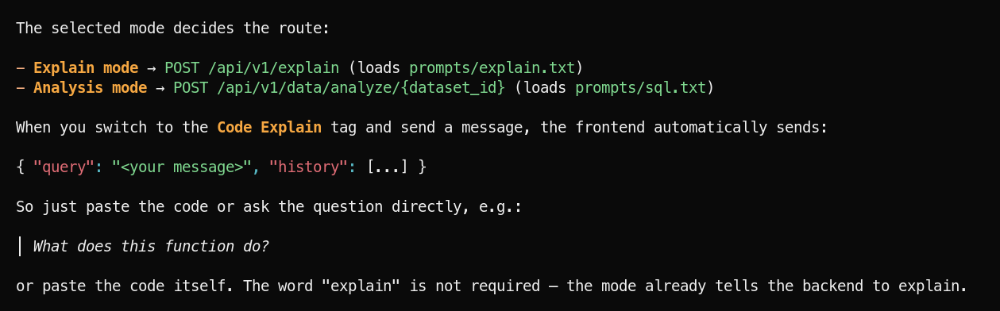

# DA Voice — Voice-Based Data Analysis System

> **Ask your data, explain your code, and generate code — by voice or text, in one focused workspace.**

[](https://www.python.org/)
[](https://fastapi.tiangolo.com/)
[](https://github.com/SYSTRAN/faster-whisper)
[](LICENSE)

DA Voice is a self-hosted AI workspace for working with **data and code in the same place**. Attach a CSV or Excel file, speak or type a question, and get a natural-language explanation with a clean result table. The same interface can explain existing code or generate new code — with no charts, no SQL in the UI, and no shared history between conversations.

## Contents

| | |
|---|---|
| [Overview](#overview) · [Screenshots](#screenshots) | [Feature highlights](#feature-highlights) · [Workspaces](#workspaces-in-detail) |
| [Architecture](#architecture) · [Context rules](#conversation-context-rules) | [Safety](#safety-and-reliability) · [API reference](#api-reference) |
| [Project structure](#project-structure) · [Getting started](#getting-started) | [Configuration](#configuration-reference) · [Service management](#service-management) |
| [Local data & privacy](#local-data-logs-and-privacy) · [Troubleshooting](#troubleshooting) | [Contributing](#contributing) · [License](#license) |

---

## Overview

The application combines three workflows behind one chat-style interface:

| Workflow | What it does |
|---|---|
| **Analysis** | Converts a question into a read-only SQLite query, runs it against an uploaded CSV/XLSX dataset, and returns an explanation plus a result table. |
| **Code Explain** | Breaks down code or answers questions about code, including purpose, control flow, edge cases, and complexity. |
| **Code Gen** | Generates or updates a complete implementation from a natural-language description. |

Voice is a first-class input: the browser records a 16 kHz WAV clip, Faster-Whisper transcribes it, and the transcript is placed in the composer so it can be reviewed or edited before sending.

### Design principles

- **SQL is internal.** Analysis responses expose the explanation and result rows, never the generated query. The UI has no SQL viewer.
- **Tables, not charts.** Results are rendered as a scrollable table with row/column counts. Charting was removed by design.
- **Conversations stay isolated.** History is carried by the browser and scoped to one conversation and one mode.
- **One mode per conversation.** A conversation locks to Analysis, Code Explain, or Code Gen after the first message (or an explicit mode choice), preventing mixed-context answers.
- **Prompts are files, not Python strings.** All system prompts live in [`prompts/`](prompts/).
- **The backend is stateless.** It stores no chat history; each request contains only the bounded context of the active conversation.

---

## Screenshots

<table>
  <tr>
    <td width="50%">
      
      <br>
      <sub><b>Analysis workspace.</b> A dataset question answered with scannable Markdown sections, persistent dataset context, and locked mode pills.</sub>
    </td>
    <td width="50%">
      
      <br>
      <sub><b>Structured results.</b> The same answer continues into a result grid with row/column counters. There is no chart and no SQL panel.</sub>
    </td>
  </tr>
  <tr>
    <td width="50%">
      
      <br>
      <sub><b>Dataset summary.</b> A one-row, six-metric answer. Inline code in the explanation maps directly to the column names in the table.</sub>
    </td>
    <td width="50%">
      
      <br>
      <sub><b>Arabic voice query.</b> A spoken Arabic question is transcribed, analyzed, and answered. Right-to-left text is rendered correctly in the chat.</sub>
    </td>
  </tr>
</table>

<p align="center">
  
  <br>
  <sub><b>Mode routing.</b> The selected workspace decides which endpoint handles the message and which prompt file is loaded; the active conversation's history travels with the request.</sub>
</p>

---

## Feature highlights

### Voice-first input

- Record from the microphone directly in the composer (up to 60 seconds).
- Audio is encoded to 16 kHz mono WAV in the browser and sent to `/api/v1/audio/transcribe`.
- Faster-Whisper applies voice-activity detection and returns `text`, detected `language`, and `duration`.
- The transcript is inserted into the textarea — nothing is sent until you review it and press send.
- Arabic and mixed-language questions are supported by the transcription layer and rendered right-to-left.

### Dataset analysis

- Upload **CSV** or **XLSX** files (10 MB default limit).
- The most recent tabular file in the conversation's dataset folder is loaded into a local SQLite cache.
- The model receives the table schema, column types, row count, and three sample rows — not the entire dataset.
- Blank, quoted, and duplicate column names are normalized before analysis.
- SQL generation is validated and retried up to three times when the model does not return a valid query.
- Results are capped at 200 rows and returned as JSON records for the table renderer.
- TXT/PDF files can be attached as notes and chunked through the process endpoint; they are not yet included in the SQL prompt.

### Focused answer rendering

- Answers appear as natural-language Markdown: headings, bold section labels, bullet/numbered lists, inline code, links, and block quotes. Analysis result sets are rendered as a separate table below the prose.
- Generated code is shown in a code block with a language label and a **Copy** button.
- The explanation types out progressively, then the result table or code block is appended.
- A thinking indicator is shown while waiting; the send button and navigation are blocked until the response finishes.
- Errors appear in a dedicated inline error box instead of breaking the conversation.

### Conversation memory

- Each request carries the active conversation's recent history:
  - last **6 messages** (3 exchanges),
  - at most **6,000 characters** in total,
  - at most **3,000 characters per message**,
  - at most **2,500 characters per code block**,
  - up to **3 preview rows** from a previous analysis result.
- History is filtered by mode, so an Analysis conversation cannot mix in Code Explain turns.
- Analysis history is tagged with its `datasetId`; after attaching a different dataset, earlier context from the old dataset is excluded.
- Failed responses are not included in history.
- The backend sanitizes and truncates the payload again, so a malformed or oversized client request cannot overflow the prompt (up to 20 messages, 6,000 characters total, 3,000 per message).

### One mode per conversation

- A new conversation starts unlocked. Choosing a different mode immediately locks the conversation to it.
- Sending the first message also locks the current mode automatically.
- The other two mode pills are dimmed and blocked; clicking them explains how to switch (start a new chat).
- The lock is persisted with the conversation, so reloading the page does not unlock it.
- Attaching a dataset switches an unlocked conversation to Analysis; dataset attachment is blocked in a conversation locked to another mode.
- Starting a new conversation resets the lock and allows a fresh mode choice.

### Prompt management

- System prompts are plain text files:
  - [`prompts/sql.txt`](prompts/sql.txt) — SQL generation and explanation rules.
  - [`prompts/explain.txt`](prompts/explain.txt) — code explanation style and context rules.
  - [`prompts/generation.txt`](prompts/generation.txt) — code generation format and JSON contract.
- [`src/helpers/prompts.py`](src/helpers/prompts.py) loads them with an in-process cache. Restart the backend after editing a prompt.

### Observability

- Application logs are written to `backend.log` at the repository root.
- The log rotates at 5 MB with up to 5 backups.
- Startup, client initialization, health checks, request failures, and SQL retry warnings are logged.
- Process stdout/stderr is also captured by `manage.sh` in the runtime directory; see [Local data, logs, and privacy](#local-data-logs-and-privacy).

---

## Workspaces in detail

### Analysis

1. Attach a CSV/XLSX file. The frontend creates a dataset ID such as `ds_<timestamp>_<name>` and uploads the file.
2. On the first question, [`SQLiteController`](src/controllers/SQLiteController.py) reads the newest tabular file and caches it as a SQLite table named `dataset` (`PRAGMA query_only = ON` during execution).
3. The schema block includes the row count, column names/types, and three sample rows.
4. The model is asked for a JSON object containing `sql` and `explanation`.
5. The server extracts and validates the query, executes it, applies the row cap, and returns only `mode`, the explanation, columns, rows, `limit`, and `max_limit`.
6. The query is never included in the response and is never rendered by the frontend.

- **Supported analysis files:** `.csv`, `.xlsx`
- **Result cap:** 200 rows per answer (the request may lower it with `limit`; values above 200 are rejected)
- **Cached database:** `src/assets/databases/<dataset_id>.db`

### Code Explain

- Send code directly, or ask a question about code from the conversation.
- Optional `language` and `context` fields are prepended to the request.
- Answers are Markdown and can include fenced code examples.
- Follow-ups such as “what does line 2 do?” resolve against the previous code because history is passed as real LangChain chat messages.

### Code Gen

- Describe a function, endpoint, algorithm, or change to previous code.
- The model returns JSON with `explanation`, `code`, and `language`.
- If the model ignores the JSON contract, the backend falls back to a fenced code block.
- If no code is returned, the request is retried once and then fails with a clear `502` message.
- The complete updated code is returned, not a diff or fragment.

---

## Architecture

### Technology stack

| Layer | Technology |
|---|---|
| Frontend | Vanilla JavaScript, HTML, CSS, Web Audio API, `localStorage` |
| API | FastAPI + Uvicorn, Pydantic schemas |
| Speech | Faster-Whisper with FFmpeg audio decoding |
| LLM | LangChain + any OpenAI-compatible Chat Completions endpoint |
| Data | pandas, SQLite, SQLAlchemy, openpyxl |
| Operations | `manage.sh`, rotating file logging |

### Request flow

```text
Browser (frontend/)
  ├── Microphone ──► WAV ──► POST /api/v1/audio/transcribe ──► Faster-Whisper
  ├── CSV / XLSX ──► POST /api/v1/data/upload/{dataset_id} ──► src/assets/datasets/
  └── Message + bounded conversation history
                              │
                              ▼
                    FastAPI (src/)
          ┌───────────────────┼───────────────────┐
          ▼                   ▼                   ▼
   Analysis mode        Explain mode        Generate mode
   prompts/sql.txt      prompts/explain.txt prompts/generation.txt
          │                   │                   │
          ▼                   ▼                   ▼
   validate SQL ──► LLM ──► Markdown ──► code + explanation
          │
          ▼
   SQLite (read-only) ──► explanation + rows
                              │
                              ▼
          Markdown explanation + result table / code block
                     (SQL never leaves the server)
```

### Request lifecycle

1. The user speaks or types a message. A voice message becomes editable text first.
2. The conversation's locked mode selects the endpoint and prompt file.
3. The frontend builds history from **only this conversation**, filtered by mode and dataset.
4. The request is sent with the message and history. No server-side session is required.
5. The backend sanitizes history, loads the relevant prompt, and calls the LLM.
6. Analysis validates and executes SQL locally; Explain and Generate return Markdown/code.
7. The UI shows a spinner, then renders the answer with the typewriter effect and appends code or the result table.
8. The answer is stored in the browser conversation and becomes part of the next request's bounded context.

---

## Conversation context rules

The context window is intentionally small and predictable. It is designed to support natural follow-ups without replaying an entire chat or leaking another conversation.

| Limit | Value |
|---|---|
| Messages sent by the UI | Last 6 (3 user/assistant exchanges) |
| Total history characters | 6,000 |
| Characters per message | 3,000 |
| Characters per included code block | 2,500 |
| Previous analysis preview | 3 rows |
| Backend hard guard | 20 messages, 6,000 total characters, 3,000 per message |
| Cross-conversation history | Never sent |

Additional behavior:

- Only messages from the active mode are eligible.
- Analysis messages are tagged with `datasetId`; messages from a replaced dataset are skipped.
- Error messages and empty answers are skipped.
- The history is trimmed from the newest turn backwards, then an orphaned assistant answer at the start is removed.
- The current question is sent separately in `question`/`query`, never duplicated inside `history`.
- [`src/helpers/conversation.py`](src/helpers/conversation.py) applies the server-side guard regardless of what the client sends.

---

## Safety and reliability

- **Read-only SQL only.** The validator accepts a single `SELECT`/`WITH` statement, rejects `INSERT`, `UPDATE`, `DELETE`, `DROP`, `ALTER`, `CREATE`, `PRAGMA`, `ATTACH`, and similar keywords, and ignores keywords inside comments/strings.
- **Database-level guard.** Queries run with `PRAGMA query_only = ON` on a local SQLite connection.
- **Row cap.** Results are limited to 200 rows; an explicit `limit` may only lower that value.
- **No SQL exposure.** The analysis response omits the generated query, and the frontend strips SQL-looking content from analysis prose before rendering as a second line of defense.
- **Bounded context.** The client caps history length, per-message size, included code blocks, and result previews; the server independently caps history length and per-message size.
- **Retries.** SQL generation retries up to 3 times; code generation retries once when the model returns no code.
- **Graceful errors.** Invalid datasets, empty questions, oversized uploads, unsupported audio, and model failures return structured JSON errors.
- **Local uploads.** Files are stored on the local filesystem; temporary audio files are deleted after transcription.
- **Secrets stay server-side.** The LLM API key is read from `src/.env` and is never sent to the browser.

> **Accuracy note:** LLM-generated explanations and queries can still be wrong. Review important results before making decisions. The UI includes a permanent disclaimer for this reason.

---

## API reference

- **Base URL:** `http://localhost:5000`
- **Interactive docs:** [`http://localhost:5000/docs`](http://localhost:5000/docs)

| Method | Endpoint | Purpose |
|---|---|---|
| `GET` | `/health` | Health check. |
| `GET` | `/api/v1/` | Application name and version. |
| `POST` | `/api/v1/audio/transcribe` | Transcribe an audio file (`multipart/form-data`). Optional `?language=ar`. |
| `POST` | `/api/v1/data/upload/{dataset_id}` | Upload a CSV/XLSX/PDF/TXT file to a dataset folder. |
| `POST` | `/api/v1/data/process/{dataset_id}` | Split an uploaded TXT/PDF notes file into chunks. |
| `POST` | `/api/v1/data/analyze/{dataset_id}` | Analyze a tabular dataset with a natural-language question. |
| `POST` | `/api/v1/explain` | Explain code or answer a code question. |
| `POST` | `/api/v1/generate` | Generate or update code. |

### Transcribe audio

```bash
curl -X POST "http://localhost:5000/api/v1/audio/transcribe?language=ar" \
  -F "file=@question.wav"
```

```json
{
  "text": "ما هو إجمالي الفواتير حسب الجنس؟",
  "language": "ar",
  "duration": 4.21
}
```

### Upload and analyze a dataset

```bash
curl -X POST "http://localhost:5000/api/v1/data/upload/ds_demo" \
  -F "file=@healthcare.csv"
```

```bash
curl -X POST "http://localhost:5000/api/v1/data/analyze/ds_demo" \
  -H "Content-Type: application/json" \
  -d '{
    "question": "total billing by gender",
    "limit": 50,
    "history": [
      {"role": "user", "content": "average billing by condition"},
      {"role": "assistant", "content": "Average billing grouped by condition."}
    ]
  }'
```

```json
{
  "mode": "analysis",
  "explanation": "**Result**\nTotal billing is highest for Female patients.",
  "columns": ["Gender", "Total Billing Amount"],
  "results": [
    {"Gender": "Female", "Total Billing Amount": 101000},
    {"Gender": "Male", "Total Billing Amount": 98500}
  ],
  "limit": 50,
  "max_limit": 200
}
```

> The response intentionally contains no `sql` field.

### Explain code

```bash
curl -X POST "http://localhost:5000/api/v1/explain" \
  -H "Content-Type: application/json" \
  -d '{
    "code": "def add(a, b):\n    return a + b",
    "language": "python",
    "history": []
  }'
```

```json
{
  "mode": "explain",
  "explanation": "The function returns the sum of two values.",
  "code": "",
  "language": "python"
}
```

### Generate code

```bash
curl -X POST "http://localhost:5000/api/v1/generate" \
  -H "Content-Type: application/json" \
  -d '{
    "query": "Add input validation and a docstring to the previous function.",
    "language": "python",
    "history": [
      {"role": "user", "content": "write add(a, b)"},
      {"role": "assistant", "content": "```python\ndef add(a, b):\n    return a + b\n```"}
    ]
  }'
```

```json
{
  "mode": "generate",
  "explanation": "The function now validates its inputs and documents its parameters.",
  "code": "def add(a, b):\n    \"\"\"Return the sum of two numbers.\"\"\"\n    ...",
  "language": "python"
}
```

### Process a notes file

```bash
curl -X POST "http://localhost:5000/api/v1/data/process/ds_demo" \
  -H "Content-Type: application/json" \
  -d '{"file_id": "data_dictionary.pdf", "chunk_size": 200, "overlap_size": 20}'
```

The response is the number of text chunks produced.

---

## Project structure

```text
.
├── frontend/
│   ├── index.html              # Application shell and composer
│   ├── app.js                  # API client, mode lock, context builder, Markdown renderer
│   └── style.css               # Dark workspace theme and ChatGPT-like typography
├── prompts/
│   ├── sql.txt                 # SQL generation rules and explanation format
│   ├── explain.txt             # Code explanation style and context rules
│   └── generation.txt          # Code generation contract
├── src/
│   ├── api/
│   │   ├── base.py             # App metadata endpoint
│   │   ├── data.py             # Upload, process, analyze
│   │   ├── audio.py            # Transcription
│   │   ├── explanation.py      # Code Explain
│   │   ├── generation.py       # Code Gen + response parsing
│   │   ├── schema/             # Pydantic request models
│   │   └── __init__.py
│   ├── clients/
│   │   ├── llm.py              # OpenAI-compatible LangChain client
│   │   └── whisper.py          # Faster-Whisper client
│   ├── controllers/
│   │   ├── AudioController.py
│   │   ├── BaseController.py
│   │   ├── DataController.py
│   │   ├── DatasetController.py
│   │   ├── ProcessController.py
│   │   └── SQLiteController.py
│   ├── helpers/
│   │   ├── config.py           # Pydantic settings
│   │   ├── conversation.py     # Context sanitization and formatting
│   │   ├── logging_config.py   # Root backend.log handler
│   │   └── prompts.py          # Prompt file loader
│   ├── models/                 # Enums and response messages
│   ├── assets/
│   │   ├── datasets/           # Uploaded datasets (runtime data)
│   │   ├── databases/          # SQLite cache (runtime data)
│   │   └── Screens/            # README screenshots
│   ├── main.py                 # FastAPI app, lifespan, routers, static frontend
│   ├── requirements.txt
│   └── .env.example
├── LICENSE
└── README.md
```

---

## Getting started

### Prerequisites

- **Python 3.10+** (the project is tested with Python 3.14).
- **FFmpeg** on `PATH` — required to decode recorded and uploaded audio for Faster-Whisper.
  ```bash
  ffmpeg -version
  ```
- An **OpenAI-compatible LLM endpoint** and API key (for example OpenRouter, OpenAI, or a local server).
- A modern browser with microphone support. Microphone access requires `http://localhost` or HTTPS.

### 1. Clone and install

```bash
git clone https://github.com/AbdelrahmanGaber528/Data-Analysis-Voice-Based-System.git
cd Data-Analysis-Voice-Based-System

python3 -m venv .venv
source .venv/bin/activate

pip install --upgrade pip
pip install -r src/requirements.txt
```

### 2. Configure the environment

```bash
cp src/.env.example src/.env
```

Edit `src/.env`:

```dotenv
APP_NAME="DA Voice"
APP_VERSION="1.0"

# Any OpenAI-compatible Chat Completions endpoint
LLM_BASE_URL="https://openrouter.ai/api/v1"
API_KEY="replace-with-your-key"
MODEL_NAME="openrouter/free"

# Uploads (MB), streaming chunk size (bytes)
FILE_ALLOWED_EXTENSION=["pdf","csv","txt","xlsx"]
FILE_MAX_SIZE=10
FILE_CHUNK_SIZE=512000

# Audio (MB) and accepted formats
AUDIO_MAX_SIZE=25
AUDIO_ALLOWED_EXTENSIONS=["wav","mp3","m4a"]

# Faster-Whisper
WHISPER_MODEL_SIZE=small
WHISPER_DEVICE=cpu
WHISPER_COMPUTE_TYPE=int8
```

`LLM_BASE_URL`, `API_KEY`, and `MODEL_NAME` must point to a working chat model. The default free model can be nondeterministic; the retry logic handles occasional irrelevant responses, but a stable model gives more consistent results.

### 3. Run services

```bash
cd src
uvicorn main:app --reload --host 0.0.0.0 --port 5000

cd frontend
python3 -m http.server 3000
```

`manage.sh` starts the backend and a static frontend server, waits for both ports, and prints the URLs. Activate your virtual environment first; the script uses the active interpreter and `uvicorn`, falling back to the system installation.

| Service | URL |
|---|---|
| Frontend | [http://localhost:3000](http://localhost:3000) |
| Backend API | [http://localhost:5000](http://localhost:5000) |
| FastAPI-served UI | [http://localhost:5000](http://localhost:5000) |
| Health check | [http://localhost:5000/health](http://localhost:5000/health) |
| Swagger docs | [http://localhost:5000/docs](http://localhost:5000/docs) |

The static frontend on port 3000 targets port 5000 on the same host. When the UI is served directly by FastAPI on port 5000, requests use the same origin.

> The first backend start downloads the Faster-Whisper model. On CPU, `small` with `int8` is a practical default; `base` is faster but less accurate.

---

## Configuration reference

Settings are read from `src/.env` by [`src/helpers/config.py`](src/helpers/config.py).

| Variable | Required | Description |
|---|---|---|
| `APP_NAME` | Yes | Name returned by `GET /api/v1/`. |
| `APP_VERSION` | Yes | Version returned by `GET /api/v1/`. |
| `LLM_BASE_URL` | Yes | OpenAI-compatible API base URL. |
| `API_KEY` | Yes | API key for the LLM provider. |
| `MODEL_NAME` | Yes | Chat model identifier. |
| `FILE_ALLOWED_EXTENSION` | Yes | JSON list of accepted upload extensions. |
| `FILE_MAX_SIZE` | Yes | Maximum upload size in MB (default `10`). |
| `FILE_CHUNK_SIZE` | Yes | Upload read chunk size in bytes (for example `512000`). |
| `AUDIO_MAX_SIZE` | Yes | Maximum audio upload size in MB (default `25`). |
| `AUDIO_ALLOWED_EXTENSIONS` | Yes | JSON list of accepted audio extensions. |
| `WHISPER_MODEL_SIZE` | Yes | Faster-Whisper model size (`base`, `small`, `medium`, ...). |
| `WHISPER_DEVICE` | Yes | `cpu`, `cuda`, or another supported device. |
| `WHISPER_COMPUTE_TYPE` | Yes | `int8` for CPU, `float16` for GPU, etc. |
| `HF_TOKEN` | No | Reserved for gated Hugging Face model downloads. |

> `src/.env` is ignored by Git. Never commit real API keys.

---

## Service management

[`manage.sh`](manage.sh) controls both services together:

| Command | Action |
|---|---|
| `./manage.sh up` or `./manage.sh start` | Start backend (`:5000`) and frontend (`:3000`). |
| `./manage.sh down` or `./manage.sh stop` | Stop both services and free both ports. |
| `./manage.sh restart` | Stop, then start both services. |
| `./manage.sh status` | Show port, PID, and health status for both. |
| `./manage.sh logs` | Stream backend and frontend process output. |

The script runs Uvicorn with `--reload` for development. For production, serve the app with a process manager or reverse proxy and remove `--reload`.

---

## Local data, logs, and privacy

| Artifact | Location | Notes |
|---|---|---|
| Uploaded datasets | `src/assets/datasets/<dataset_id>/` | Original CSV/XLSX/PDF/TXT files. Runtime data; keep out of version control. |
| SQLite cache | `src/assets/databases/<dataset_id>.db` | Rebuilt automatically when the source file is newer. |
| Conversations | Browser `localStorage` key `da_voice_workspace_conversations_v5` | Includes messages, mode lock, dataset reference, and up to 100 stored rows per answer. Clearing site data resets the workspace. |
| Application log | `backend.log` at the repository root | Rotates at 5 MB × 5 backups. |
| Process output | `/tmp/da_voice_<uid>/backend.log`, `/tmp/da_voice_<uid>/frontend.log` | Uvicorn/static-server stdout, tailed by `./manage.sh logs`. |
| Temporary audio | System temp directory | Deleted immediately after transcription. |

**What leaves the machine:** the question, the active conversation history (which can include earlier explanations, code, and up to three result preview rows), and — for Analysis — the table schema plus three sample rows are sent to the configured LLM endpoint. The complete dataset is **not** uploaded to the model. Audio is transcribed locally by Faster-Whisper. The generated query is executed locally and the SQL text is never returned to the browser.

---

## Troubleshooting

| Symptom | What to check |
|---|---|
| `Port 5000/3000 already in use` | Run `./manage.sh status`, then `./manage.sh restart`. |
| Backend fails at startup | Confirm `src/.env` exists and includes every required key, especially `FILE_CHUNK_SIZE`. |
| Microphone button does nothing | Open the app through `localhost` or HTTPS; browsers block microphone access on insecure origins. |
| “Could not start recording” | Grant microphone permission and check that no other app is using the device. |
| Audio transcription is slow | The Whisper model runs locally. Use `WHISPER_MODEL_SIZE=base` or `small` with `WHISPER_DEVICE=cpu` and `WHISPER_COMPUTE_TYPE=int8`. |
| `ffmpeg` not found | Install FFmpeg and ensure it is on `PATH`. |
| `401`/`403` from the model | Verify `LLM_BASE_URL`, `API_KEY`, and `MODEL_NAME`, and that the provider supports the Chat Completions API. |
| Analysis says the dataset was not found | Upload the CSV/XLSX again; uploads are not stored in Git and may have been cleaned up. |
| Model returns irrelevant text | Free/auto-routed models sometimes do this. Retry, or choose a more stable model. SQL requests already retry three times. |
| UI looks stale after an update | Hard-refresh (`Ctrl+Shift+R`). The HTML uses cache-busting query strings for `app.js` and `style.css`. |
| Conversation history seems wrong | Start a new conversation or clear the site's `localStorage`. The backend does not keep a second copy. |

---

## Contributing

1. Create a branch for your change.
2. Keep prompts in `prompts/` rather than hardcoding them in Python.
3. Preserve the frontend contract: analysis responses must not include SQL, and conversation history must remain scoped to one conversation and mode.
4. Before opening a pull request, run:

   ```bash
   python -m compileall -q src
   node --check frontend/app.js
   ./manage.sh restart
   ```

---

## License

Licensed under the **Apache License 2.0**. See [`LICENSE`](LICENSE) for details.

Copyright 2026 Abdelrahman Gaber.
